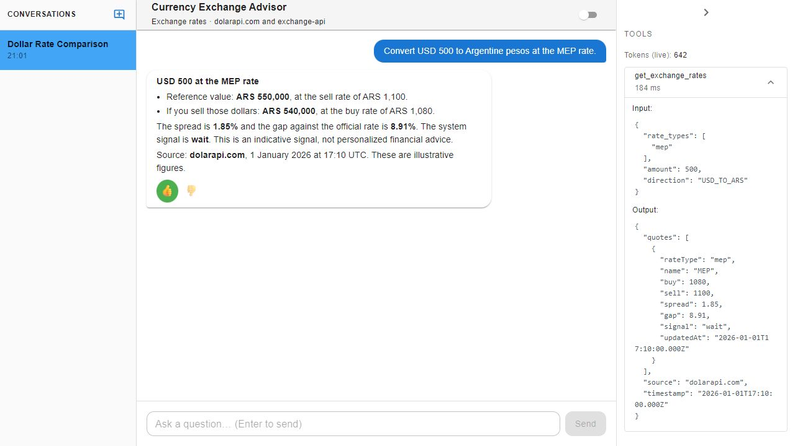
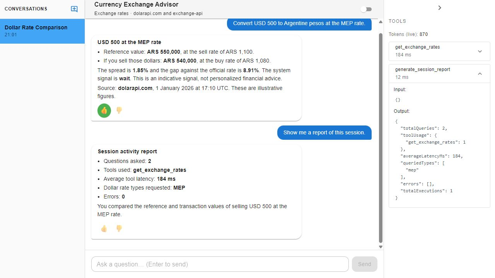
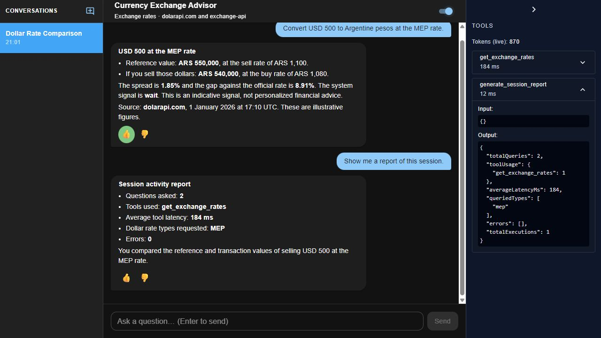

# Currency Exchange Advisor

Currency Exchange Advisor is an AI chat application that helps people understand Argentina’s currency exchange market. Users can compare seven US dollar exchange rates, convert US dollars and 15 other currencies to or from Argentine pesos, and get plain-English explanations of prices, spreads, and indicative trading signals. The app keeps separate conversation histories and shows the data sources and tools behind each answer.


[Live demo](https://gleniproject.vercel.app/) · [Architecture and API contracts](docs/architecture.md)

## Why I built it

Argentina has several dollar exchange rates, including the official, blue, MEP, and CCL rates. Comparing them means understanding different prices, transaction methods, and buy/sell spreads. I built this application as a university technical assignment to bring that information into a single conversation and make the underlying calculations easy to inspect.

The project demonstrates a complete application: a React interface, an Express API, an AI agent that calls server-side tools, external market data integrations, persistent chat history, and automated tests.

## What it does

- **Compares dollar rates:** official, blue, MEP, CCL, wholesale, crypto, and card. Each quote includes its buy/sell prices, spread, gap against the official rate, and a `buy`, `wait`, or `neutral` signal calculated from configurable thresholds.
- **Converts currencies in both directions:** USD, EUR, BRL, CLP, UYU, MXN, COP, PEN, PYG, BOB, VES, GTQ, HNL, NIO, CRC, and DOP against ARS.
- **Explains the price you would actually receive or pay:** distinguishes a reference conversion at the sell price from a transaction at the applicable buy or sell price.
- **Streams answers as they arrive:** uses server-sent events (SSE), with a thinking indicator and tool activity updates.
- **Manages independent conversations:** generates an English title after the first exchange and supports switching, renaming, and deleting conversations.
- **Preserves session history:** stores messages, tool executions, and response feedback in Supabase.
- **Makes agent activity visible:** a collapsible panel shows tool inputs, outputs, latency, and live token usage. A session report summarizes queries, tool usage, queried rate types, and errors.
- **Supports light and dark themes**, keyboard interaction, accessible labels, and Markdown answers.

Signals are simple application heuristics, not forecasts or personalized financial advice. The assistant stays within its currency exchange domain and does not predict future prices.

## Screenshots

The screenshots below use illustrative data to demonstrate the interface; they are not current market quotes.

| Exchange rates | Session report | Dark mode |
| --- | --- | --- |
|  |  |  |

## Data sources

| Coverage | Source | Price type | Cache |
| --- | --- | --- | --- |
| Seven Argentine dollar rate types | dolarapi.com | Separate buy and sell prices | 45 seconds by default |
| Dollar fallback: official and blue only | Bluelytics | Separate buy and sell prices | Same dollar cache |
| EUR, BRL, CLP, UYU against ARS | dolarapi.com | Separate buy and sell prices | 45 seconds by default |
| MXN, COP, PEN, PYG, BOB, VES, GTQ, HNL, NIO, CRC, DOP against ARS | fawazahmed0/exchange-api | Daily interbank reference rate; buy equals sell | 6 hours |

The dollar client automatically falls back to Bluelytics if its primary request or validation fails. The reference-rate client tries a second CDN if its primary request fails. These sources do not require API keys.

Every market-data tool returns its source and timestamps. The prompt requires the assistant to cite them, disclose partial data, and explain when a result uses an interbank reference rate rather than an Argentine exchange bureau quote. Cached and daily reference data should not be interpreted as live executable prices.

## How it works

1. The client sends a question and an optional conversation ID to the API.
2. The backend validates the request, saves the user’s message, and loads the conversation history.
3. The agent decides whether it needs a dollar quote, another currency rate, or a session report. Conceptual questions can be answered without tools.
4. The selected tool retrieves or reads the data, performs calculations on the server, and validates its output before returning it to the model.
5. The model explains the result while the API streams text and activity events to the client.
6. The backend saves the answer and returns the message ID and conversation title.

The agent can chain tool calls across a bounded loop of four model completions. Tools requested in the same completion run concurrently.

## Stack

| Area | Technologies |
| --- | --- |
| Frontend | React, TypeScript, Vite, Material UI, Tailwind CSS |
| Backend | Node.js, Express, CommonJS |
| AI | OpenAI Chat Completions API; `gpt-4o-mini` by default |
| Persistence | Supabase / PostgreSQL |
| Validation | Zod |
| Tests | Jest, Supertest |
| Deployment | Vercel |

## Run locally

Use Node.js 22 or later, npm, an OpenAI API key, and a Supabase project with the required tables. The repository does not include a database provisioning migration; the expected tables and relationships are documented in [the architecture guide](docs/architecture.md#persistence).

1. Clone the repository and open its root directory.
2. Copy `.env.example` to `backend/.env`, then fill in the Supabase and OpenAI credentials. Keep credentials out of version control.
3. Install both sets of dependencies:

   ```sh
   npm ci
   npm ci --prefix client
   ```

4. Start the backend in one terminal:

   ```sh
   npm run dev
   ```

5. Start the frontend in another terminal:

   ```sh
   npm run dev --prefix client
   ```

Open the local URL printed by Vite, normally `http://localhost:5173`. The backend uses port `3000` by default, and Vite forwards `/api` requests to it.

Example questions:

- “Compare the blue and MEP dollar rates.”
- “Convert USD 500 to Argentine pesos at the MEP rate.”
- “How many Colombian pesos is ARS 100,000?”
- “Show me a report of this session.”

### Configuration

| Variable | Purpose | Default |
| --- | --- | --- |
| `SUPABASE_URL` | Supabase project URL | Required |
| `SUPABASE_ANON_KEY` | Database key used by the backend | Required |
| `OPENAI_API_KEY` | OpenAI key used by the backend | Required |
| `OPENAI_MODEL` | Model used for chat and title generation | `gpt-4o-mini` |
| `CORS_ORIGIN` | Exact allowed frontend origin | `http://localhost:5173` in development; cross-origin access disabled in production |
| `PORT` | Local backend port | `3000` |
| `OPENAI_TIMEOUT_MS` | Streaming request timeout | `30000` |
| `EXCHANGE_CACHE_TTL_MS` | Dollar and regional buy/sell quote cache lifetime | `45000` |
| `HIGH_SPREAD_THRESHOLD` / `LOW_SPREAD_THRESHOLD` | Spread thresholds, in percent | `2.5` / `1.5` |
| `HIGH_GAP_THRESHOLD` / `LOW_GAP_THRESHOLD` | Official-rate gap thresholds, in percent | `8` / `3` |

The backend checks required configuration at startup. Lower thresholds must be below their corresponding upper thresholds.

### Tests and production build

```sh
npm test -- --runInBand
npm test -- --runInBand --testPathPattern=exchangeService
npm run build --prefix client
```

Tests use mocked OpenAI, market-data, and persistence boundaries so they can verify application behavior without live credentials or network access. They cover rate calculations, conversion direction, tool orchestration, public API responses, feedback, and request limits. These tests do not establish the availability of live services.

## Design choices

**A modular monolith.** Routes and controllers handle HTTP; services coordinate the application; tools own agent capabilities; repositories handle persistence; infrastructure modules wrap providers. This keeps responsibilities clear without adding microservices or a class hierarchy the project does not need.

**One tool registry.** Tool definitions and handlers come from `backend/tools/index.js`. Adding a capability does not require another branch in the agent’s orchestration loop.

**Explicit boundaries.** DTO factories select public fields rather than exposing raw database rows. Provider-specific Spanish keys are translated into English at the integration boundary. The client and server use English field names and event types.

**Shared calculations and validation.** Both currency tools use the same conversion service. Conversation routes share UUID validation. The existing functional style remains in place: the design principles guide separation and dependencies without forcing object-oriented patterns into every module.

**Provider streaming stays in infrastructure.** The stream client assembles OpenAI text and tool-call deltas and emits application events through a callback. The agent handles conversation flow, while the controller writes SSE events.

**Best-effort execution logging.** A failed tool-execution insert is logged without discarding the answer. Token usage is stored separately from tool rows using `_turn` records because the provider reports usage per model completion, not per individual tool.

**English migration with existing-data support.** Browser conversation metadata is migrated to English storage keys without changing IDs or historical messages. Legacy threshold environment variables are still accepted. The existing Supabase `titulo` column and historical `_turno` marker are handled at the repository boundary, so no database rename is required. Deploy the client and backend together because the public API fields and SSE events now use English names.

## Deploy to Vercel

1. Connect the repository to a Vercel project.
2. Configure the required environment variables using `.env.example` as a reference. Production reads them from the platform environment.
3. Set `CORS_ORIGIN` if a separate frontend origin needs access.
4. Deploy the project. `vercel.json` builds the Vite client and routes API requests through `api/index.js`.
5. Check `/api/health` and test a chat request against the deployed application.

## Current limitations

- **No authentication or conversation ownership checks.** Conversation access relies on possession of its UUID. This is a demonstration application, not a multi-user production security model.
- **Database access policies need deployment review.** The original project used Supabase tables with row-level security disabled. The key is used only on the server, but that alone does not provide row-level isolation. The repository cannot verify the current database policy configuration.
- **In-memory caches and request limits.** Each process has its own cache and ten-requests-per-minute IP limit. Multiple instances do not share state.
- **Unbounded conversation context.** Each turn loads the full message history, so long chats increase context usage and cost.
- **Incomplete turns after provider failures.** The user’s message is saved before the model is called; a later failure can leave the conversation without a matching answer.
- **Optimistic conversation deletion.** The sidebar removes a conversation before the server confirms deletion; a server failure currently only produces a console log.
- **Manually maintained client/server types.** Backend DTOs and frontend TypeScript interfaces are separate. Contract tests help, but shared types or a generated API specification would reduce drift.
- **Backend TypeScript migration.** A migration was started on the separate [TypeScript branch](https://github.com/NicolasCandal/Gleni-challenge-tecnico/tree/TypeScript), but the submitted application kept the stable JavaScript backend. Completing that migration remains a possible follow-up.
- **Multiple styling systems.** Material UI and Tailwind share the same theme state, with local `sx` overrides. This works but adds styling maintenance.

See [the architecture guide](docs/architecture.md) for the request flow, API contracts, persistence model, and calculation rules.
